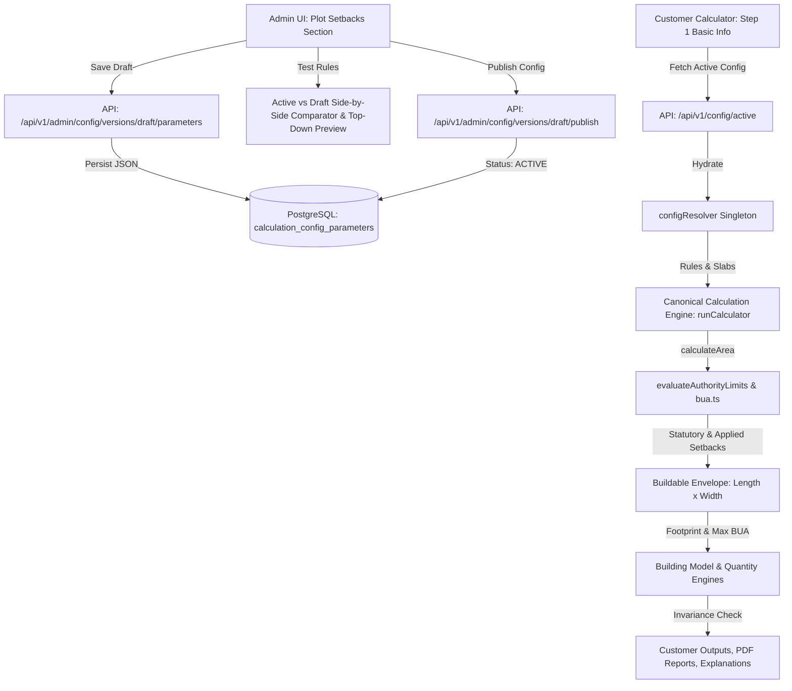

# HUTTY — Plot Setback System V2: Repository & Architectural Audit

**Document Version:** 1.0.0  
**Date:** October 2026  
**Auditor:** Antigravity Engineering  
**Scope:** Residential projects up to G+4 (Building height ≤ 12 m / ~39.37 ft). Integration with PostgreSQL, Admin Configuration Lifecycle, and Canonical Calculator.

---

## 1. Executive Summary & Defect Root Cause

### The Problem
The client reported that Hutty's current residential setback calculations produce incorrect outputs for Bengaluru projects. 

### Audit Findings & Root Causes
1. **Outdated Reference Slabs:** The existing `src/calculation-engine/data/authorityRules/bengaluru.ts` file was based on static metric conversions from the BDA Revised Master Plan 2015 (RMP-2015), applying fixed numbers such as $1.0\text{ m} \approx 3.28\text{ ft}$ across standard $30 \times 40$ sites.
2. **Missing Dynamic Percentage Formulas:** The *Karnataka Gazette amendment dated 5 January 2026* (`GBA_Setback_Rules_Feet_Reference.pdf`) introduced percentage-of-depth and percentage-of-width formulas for medium and large residential plots ($1,615 \text{ sq.ft} - 43,056 \text{ sq.ft}$):
   - Front Setback: $12\% \times \text{plot depth}$
   - Rear Setback: $8\% \times \text{plot depth}$
   - Side Setbacks: $8\% \times \text{plot width}$ on each side
   The existing engine assumed fixed numbers across all slabs (`frontSetbackFt`, `rearSetbackFt`, etc.) and lacked support for percentage-based boundary calculations.
3. **Improper Single-Side Handling:** For plots up to $1,615 \text{ sq.ft}$, the 2026 Gazette specifies setbacks on *"one side"* ($1.97\text{ ft}$ for $\le 646\text{ sq.ft}$ and $2.30\text{ ft}$ for $646-1,615\text{ sq.ft}$), whereas the legacy code applied bilateral side setbacks ($3.28\text{ ft}$ left and $3.28\text{ ft}$ right), constricting the buildable envelope by over $6.5\text{ ft}$.
4. **Silent Defaulting of Unspecified Requirements:** For micro-plots ($\le 646\text{ sq.ft}$), the Gazette summary states that the rear setback is *"Not specified in this row"*. The legacy system either defaulted this to $0\text{ ft}$ or an arbitrary value without notifying the user or marking the buildable footprint as pending plan-sanction confirmation.
5. **No Dedicated Admin Management Interface:** The Admin Panel only offered a generic `project-bua` section with coverage ratios and super-BUA factors. Administrators could not inspect, edit, test, activate, or rollback plot-area setback rules or boundary calculation methods without code deployments.

---

## 2. Comprehensive Trace of Existing Data Flow

The canonical calculation and configuration lifecycle flows through the following stages:

### Module Audit
- **`src/calculation-engine/data/authorityRules/types.ts`**: Contains `SetbackRuleSlab`, `FARRuleSlab`, and `AuthorityCalculationResult`. Needs expansion to support boundary-specific calculation methods (`FIXED_DISTANCE`, `PERCENT_OF_DEPTH`, `PERCENT_OF_WIDTH`, `MINIMUM_REQUIRED`, `UNSPECIFIED`), verification statuses, and single-side vs both-sides conditions.
- **`src/calculation-engine/data/authorityRules/index.ts`**: Exports `evaluateAuthorityLimits`. Must be upgraded to evaluate dynamic rules, road frontages, and boundary methods dynamically while resolving overrides from `configResolver`.
- **`src/calculation-engine/modules/bua.ts`**: Consumes `evaluateAuthorityLimits` and computes `buildableLengthFt`, `buildableWidthFt`, and `buildableFootprintSqFt`.
- **`src/calculation-engine/config/configurationResolver.ts`**: Central client resolver. Stores `parameterStore` and bridges active parameters from PostgreSQL.
- **`server/prisma/schema.prisma`**: Models `CalculationConfigVersion` and `CalculationConfigParameter` already support `valueJson` with indexing by `versionId` and `key`, and audit logging via `CalculationConfigAuditLog`.
- **`server/src/services/configVersion.service.ts`**: Manages drafts, parameters, schema validation, simulations, atomic publication, and rollback.
- **`src/features/admin/AdminPage.tsx`**: Tab-based ops console. Requires integration of the dedicated `plot-setbacks` section under Group 01 (Project & Planning).

---

## 3. Scope Boundaries & Non-Functional Invariants

1. **Height Exclusions:** Under strict instruction, Section 3 of the PDF (*Taller buildings — preliminary height-based guide*) is **excluded**. All logic is constrained to residential projects up to G+4 ($\le 12\text{ m} / ~39.37\text{ ft}$).
2. **Quantity and Cost Invariance:** A change in setback rules modifies only the physical buildable envelope and permissible footprint. Changing a setback rule does **not** alter unit material rates, labor rates, or trade parameters if the customer's chosen physical house dimensions remain unchanged.
3. **No Arbitrary Assumptions:** Any unverified or unspecified rule (such as the rear setback for plots $\le 646\text{ sq.ft}$) is explicitly flagged as `UNSPECIFIED` / Requires Review. The calculator will communicate the statutory uncertainty transparently rather than manufacturing a false guarantee of sanction.

---

## 4. Planned Changes for Plot Setback System V2

1. **Types & Registry (`types.ts`, `bengaluru.ts`, `canonicalConfig.ts`):**
   - Introduce `PlotSetbackRule`, `BoundaryRequirement`, `SetbackMethod`, and `VerificationStatus`.
   - Seed baseline rules using exact figures from `GBA_Setback_Rules_Feet_Reference.pdf`.
2. **Canonical Engine Integration (`index.ts`, `bua.ts`):**
   - Enhance `evaluateAuthorityLimits` to match plot area, evaluate boundary methods (fixed vs depth-% vs width-%), calculate independent left/right side rules, and handle multi-road frontages / corner plots.
   - Connect dynamic configuration resolution via `configResolver.resolveParameter('config.setbacks.rules')`.
3. **Admin Panel Expansion (`PlotSetbacksSection.tsx`):**
   - Build a comprehensive, responsive admin interface featuring:
     - **Rule Library:** List, view, edit, duplicate, activate, archive rules with conflict detection.
     - **Boundary Editors:** Independent Front, Rear, Left, Right controls with automatic input shifting based on method.
     - **Plot Conditions:** Rectangular geometry, corner plot (multiple road frontages), road widening, manual overrides with reason.
     - **Test Setback Rules Workflow:** Side-by-side Active vs Draft simulation with an interactive SVG top-down plot footprint preview.
4. **Customer Calculator Transparency (`Step1BasicInfo.tsx`):**
   - Show clear, plain-language setback cards with the applied rule name, boundary breakdown, and planning status disclaimers.
5. **Testing & Regression Suite:**
   - Add unit tests covering the 6 common plot sizes ($20\times 30$, $30\times 40$, $30\times 50$, $40\times 60$, $50\times 80$, $60\times 80$), boundary thresholds, draft isolation, and PostgreSQL configuration lifecycle.
