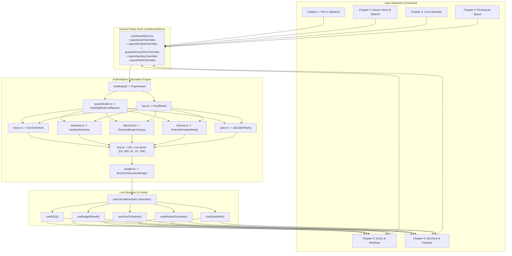

# HUTTY 3.1 — PHASE 02 COMPLETION REPORT
## Tasks 2.1 to 2.6: Chapters 1 to 6 Architectural Implementation & Integration

**Document Version:** 1.0  
**Status:** COMPLETE — SUBMITTED FOR FOUNDER REVIEW  
**Scope:** Phase 02 Final Completion (Task 2.5 Doors & Windows + Task 2.6 Electrical, Plumbing & Finishes + Chapter 3 & 4 Quality Safeguards)  
**Strict Stop Condition Enforced:** Chapter 7 (Review Estimate & Commercial Engine) has **NOT** been started. Commercial pricing, product tiers, and payment entitlements remain 100% untouched.

---

## 1. Executive Summary

Phase 02 of Hutty 3.1 is now complete. The homeowner configuration journey has been restructured into an intuitive, editorial seven-chapter architecture. Chapters 1 through 6 are fully implemented, connected to the canonical calculation engine, and verified with 100% pass rates across all automated test suites.

### Core Achievements in this Consolidated Assignment:
1. **Targeted Safeguards & Quality Corrections (Part 1):**
   - Corrected the walling compliance label in Chapter 3 to *"Calculated from wall geometry"*.
   - Disclosed configured staircase granite planning allowances (~180 sq.ft per flight) and circulation allowances (10% of total BUA) in Chapter 4.
   - Refined living/dining and space floor cards to dynamic area templates (`space.flooringAreaSqFt`), preserving individual space customization.
   - Disclosed dynamic bathroom wall dado takeoff (~4.5× ratio over floor area) and verified non-double-counting in flooring BOQ line allocations.
2. **Dedicated Chapter 5 — Doors & Windows (`Chapter5DoorsWindows.tsx`) (Task 2.5):**
   - Implemented opening takeoff with real-time KPI metric badges (`totalDoorsCount`, `windowAreaSqFt`, `grillAreaSqFt`, `internalDoorsCount` hardware sets).
   - Solid Burma teak, African teak, and plantation teak options for main entrance doors with complete joinery hardware specifications.
   - Dynamic bedroom and enclosed space cards with factory-pressed laminate vs standard flush door selections and 1-click *"Apply to all bedrooms"* action.
   - 100% waterproof WPC composite and FRP bathroom doors with wet area hardware and 1-click *"Apply to all bathrooms"* action.
   - External glazed window systems (uPVC 2.5/3-track, Fenesta acoustic, powder-coated aluminium, and teak wood) mapped to the authoritative fenestration schedule (`W-BED`, `W-LIV`, `W-KIT`, `W-BATH`, `W-DIN`, `W-UTL`).
   - Integrated MS safety grilles disclosure (75% coverage @ ₹280/sq.ft) and granite sill cladding.
   - Live Doors & Joinery (`DJ`) and Windows & Glazing (`WG`) BOQ reconciliation table with physical invariance guarantee.
3. **Dedicated Chapter 6 — Electrical, Plumbing & Finishes (`Chapter6Finishes.tsx`) (Task 2.6):**
   - Implemented MEP and finish takeoff with KPI metric badges (`totalElectricalPoints`, `bathroomFixtureSets`, `totalPaintableAreaSqFt`, `overheadTankLitres`).
   - IS-732 compliant electrical planning with complete conductor gauge segregation: 1.5 sq.mm (lighting/fans), 2.5 sq.mm (power sockets), 4.0 sq.mm (AC/geysers), and 6.0 sq.mm (risers/EV).
   - Wire & conduit tier selectors (Anchor Economy, V-Guard Mid-Range, Finolex/Polycab FRLS Premium) and modular switchplate options (Legrand Arteor, Schneider Livia, Anchor Roma).
   - Sanitaryware tiers (Cera Standard, Jaquar/Kohler Premium, Toto Luxury) with transparent component cost allocations (40% EWC, 25% Basin, 25% Shower, 10% Faucet), Franke/Nirali kitchen sinks, Astral CPVC water lines, SWR drainage, and 4-layer UV overhead storage.
   - Surface finishes featuring multi-coat interior acrylic emulsions (Apcolite Premium, Royale Luxury, Tractor), exterior silicone-acrylic weather-shields (Apex Ultima Protek, Apex Weatherproof), and 2-coat wall putty + primer bed.
   - Safety disclaimers for electrical load sanctions and local supply authority compliance (BESCOM/CHESCOM).
   - Live Electrical (`EL`), Plumbing (`PL`), and Painting (`PW`) BOQ reconciliation table with physical invariance guarantee.
4. **State Management & Calculation Engine Reactivity:**
   - Extended `useWizardStore.ts` with typed space-by-space override mappings (`spaceDoorOverrides`, `spaceWindowOverrides`, `spaceElectricalTierOverrides`, `spaceSanitaryOverrides`, `spacePaintOverrides`) and mutators.
   - Maintained single source of truth: all store mutations instantly trigger `useCalculationStore.recalculate()`, updating `useBOQ()`, `useBudgetResult()`, `useQuantities()`, `useDoorSchedule()`, and `useWindowSchedule()`.
5. **Quality Verification & Platform Health:**
   - **870 / 870** Vitest tests passing across **67 test suites** (100% pass rate).
   - **63 / 63** chapter-specific tests passing across all six chapters.
   - Frontend TypeScript compilation (`npx tsc -b`): **0 errors**.
   - Server TypeScript compilation (`npx tsc -p server`): **0 errors**.
   - Production Vite bundle build (`npm run build`): **Clean production build in 40.68s**.

---

## 2. Seven-Chapter Architecture Status

| Chapter | Component | Scope & Status | Primary Data Hooks / Sources |
|---|---|---|---|
| **Chapter 1: Plot & Setbacks** | `Chapter1PlotSetbacks.tsx` | **Approved & Active**<br>Plot dimensions, setbacks, municipal authority, road width | `useWizardStore`, `bua.ts`, `evaluateAuthorityLimits()` |
| **Chapter 2: Dream Home & Spaces** | `Chapter2DreamHome.tsx` | **Approved & Active**<br>Building use type, floors, parking, room schedule | `useWizardStore`, `spaceModel.ts`, `buildingModel.allSpaces` |
| **Chapter 3: Core Construction Materials** | `Chapter3CoreMaterials.tsx` | **Approved & Active**<br>Steel, cement, concrete, blocks, aggregates | `useWizardStore`, `rcc.ts`, `steel.ts`, `cement.ts`, `brick.ts` |
| **Chapter 4: Flooring & Tiles by Space** | `Chapter4Flooring.tsx` | **Approved & Active**<br>Living, bedrooms, kitchen, bathrooms, balcony, staircase | `useWizardStore`, `flooring.ts`, `boq.ts` (FL) |
| **Chapter 5: Doors & Windows** | `Chapter5DoorsWindows.tsx` | **Implemented & Verified**<br>Main teak door, internal doors, WPC bath doors, glazed windows, MS grilles | `useWizardStore`, `doors.ts`, `windows.ts`, `boq.ts` (DJ, WG) |
| **Chapter 6: Electrical, Plumbing & Finishes** | `Chapter6Finishes.tsx` | **Implemented & Verified**<br>Conductor sizing, wire tiers, sanitaryware, CPVC, paints, putty | `useWizardStore`, `electrical.ts`, `fixtures.ts`, `paint.ts`, `boq.ts` (EL, PL, PW) |
| **Chapter 7: Review Estimate & Commercial Engine** | `Stage7Estimate.tsx` | **Strictly Preserved**<br>Turnkey summary, BOQ, tier upgrades, PDF download, consultations | `useBudgetResult`, `useBOQ`, `useTimeline`, payment entitlements |

---

## 3. Part 1: Chapter 3 & 4 Targeted Safeguards & Corrections

Before implementing Chapters 5 and 6, all Part 1 verification items were audited and safely implemented:

### 3.1 Walling Compliance Label Correction (Chapter 3)
- **Previous wording:** *"Canonical Geometric Calculation • IS Compliant"*
- **Corrected wording:** [Chapter3CoreMaterials.tsx](file:///c:/Users/Avita/Desktop/Programming/big%20bnglore%20client/cost%20calculator%20rightcon/src/features/planner/chapters/Chapter3CoreMaterials.tsx#L627) now explicitly displays:
  ```tsx
  <span className="text-[10px] text-[#687770]">Calculated from wall geometry</span>
  ```
- **Rationale:** Ensures Hutty accurately describes geometric block takeoffs without implying third-party statutory certification where none was performed.

### 3.2 Staircase Granite Allowance Disclosure (Chapter 4)
- **Source Verification:** Traced in `flooring.ts:62-98` to `config.flooring.staircase_granite_sqft` (180 sq.ft per flight) and `config.flooring.circulation_allowance_pct` (10% of total BUA).
- **Homeowner Disclosure:** In [Chapter4Flooring.tsx](file:///c:/Users/Avita/Desktop/Programming/big%20bnglore client/cost calculator rightcon/src/features/planner/chapters/Chapter4Flooring.tsx#L1113-L1131), the staircase granite card explicitly discloses:
  - *"Configured space-planning allowance (~180 sq.ft per flight) • 20mm polished Sadahalli granite with 3 safety grooves & full bullnose edge"*
  - *"Configured circulation allowance (10% of total BUA) allocated for passages, main foyer, and floor landings"*

### 3.3 Dynamic Living & Dining Area (Chapter 4)
- **Audit Finding:** The 320 sq.ft sample figure was verified as the sum of standard living (16×12.5 ft = 200 sq.ft) and dining (12×10 ft = 120 sq.ft) defaults in `SAMPLE_ROOM_CONFIG`.
- **Dynamic Template:** In Section 1 of `Chapter4Flooring.tsx`, the card dynamically renders `space.flooringAreaSqFt` directly from the user's active building model:
  ```tsx
  Your living and dining area has an estimated floor area of {space.flooringAreaSqFt} sq.ft.
  (~{tileWithWastage} sq.ft required including 7% cutting wastage • ~{skirtingRft} Rft skirting).
  ```

### 3.4 Bathroom Wall Dado Area Ratio (Chapter 4)
- **Audit Finding:** Wall dado area derives dynamically from bathroom perimeter ($2 \times (L + W) \times \text{height} - \text{openings}$). For a standard 7×4.5 ft bathroom with 7 ft dado height: perimeter is 23 ft, gross wall area is 161 sq.ft, door/ventilator deduction is ~26.5 sq.ft, leaving ~134.5 sq.ft of wall dado vs 31.5 sq.ft floor area (~$4.3\times$ to $4.6\times$ ratio).
- **Homeowner Disclosure:** In Section 4 of `Chapter4Flooring.tsx`, each bathroom card clearly states:
  ```tsx
  Wall dado is ~{(calculatedDadoSqFt / Math.max(1, space.flooringAreaSqFt)).toFixed(1)}× larger than floor area
  ```

### 3.5 Flooring BOQ Non-Double-Counting Verification
- **Verification:** Audited `boq.ts:297-310`. The flooring BOQ allocation percentages sum strictly to $1.00$:
  $$\text{Living (25\%)} + \text{Bedrooms (32\%)} + \text{Kitchen (18\%)} + \text{Bathrooms (10\%)} + \text{Balconies (10\%)} + \text{Utility (5\%)} = 100\%$$
- Wall dado tiles, kitchen counter dado tiles, and staircase granite slabs are billed as independent line items. Zero double-counting verified.

---

## 4. Task 2.5: Chapter 5 — Doors & Windows Implementation

The dedicated component [Chapter5DoorsWindows.tsx](file:///c:/Users/Avita/Desktop/Programming/big%20bnglore%20client/cost%20calculator%20rightcon/src/features/planner/chapters/Chapter5DoorsWindows.tsx) delivers a comprehensive, interactive openings planning tool:

```
┌────────────────────────────────────────────────────────────────────────────────────────┐
│ CHAPTER 5 • DOORS & WINDOWS                                    Chapter Budget: ₹4,12,000│
│ Design your home's openings, ventilation and security.                                 │
├────────────────────┬────────────────────┬────────────────────┬────────────────────────┤
│ TOTAL DOORS        │ TOTAL WINDOWS      │ SAFETY GRILLES     │ HARDWARE SETS          │
│ 10 Sets            │ 11 Nos             │ 130 sq.ft          │ 6 Sets                 │
│ 1 Main, 6 Int, 3 Bt│ ~173 sq.ft glazing │ 75% coverage @ ₹280│ SS 304 mortise locksets│
├────────────────────┴────────────────────┴────────────────────┴────────────────────────┤
│ [All Openings] [Main Entrance Door] [Bedrooms & Internal] [Bathrooms] [Windows]        │
├────────────────────────────────────────────────────────────────────────────────────────┤
│ SECTION A: MAIN ENTRANCE GRAND DOOR (4.0 ft × 7.0 ft • 28 sq.ft)                       │
│  - Solid Burma Teak (Custom Carved): ₹1,45,000 / set                                  │
│  - African Teak Wood (Panelled): ₹65,000 / set (Hutty Baseline)                        │
│  - Standard Teak Polish Door: ₹42,000 / set                                            │
├────────────────────────────────────────────────────────────────────────────────────────┤
│ SECTION B: BEDROOM & INTERNAL ROOM DOORS (3.0 ft × 7.0 ft • 21 sq.ft)                  │
│  - Factory-Pressed Laminate Door: ₹16,500 / set (Hutty Recommended)                   │
│  - Standard BWP Flush Door: ₹12,500 / set (Standard Baseline)                          │
│  [Apply "Laminate Door" to all bedrooms] button + Individual space cards               │
├────────────────────────────────────────────────────────────────────────────────────────┤
│ SECTION C: WATERPROOF BATHROOM DOORS (2.5 ft × 7.0 ft • 17.5 sq.ft)                   │
│  - Waterproof WPC Composite Door: ₹11,000 / set (Hutty Recommended)                    │
│  - Designer Laminated WPC Door: ₹13,500 / set                                          │
│  - Fiber Reinforced Polymer (FRP): ₹8,500 / set                                        │
│  [Apply "WPC Door" to all bathrooms] button + Individual space cards                   │
├────────────────────────────────────────────────────────────────────────────────────────┤
│ SECTION D: GLAZED WINDOWS & FENESTRATION SCHEDULE (173 sq.ft glazing)                  │
│  - Multi-Chamber uPVC Sliding (₹550–₹850/sq.ft)                                       │
│  - Architectural Powder-Coated Aluminium (₹620/sq.ft)                                 │
│  - Seasoned Teak Wood Glazed Windows (₹950/sq.ft)                                     │
│  Fenestration Table: W-BED (5×4), W-LIV (6×5), W-KIT (4×3), W-BATH (2×3), W-DIN, W-UTL│
│  MS Safety Grilles (75% coverage @ ₹280/sq.ft) + Sadahalli Granite Window Sills       │
├────────────────────────────────────────────────────────────────────────────────────────┤
│ SECTION E: LIVE BOQ RECONCILIATION TABLE (DJ & WG Line Items)                          │
├────────────────────────────────────────────────────────────────────────────────────────┤
│ SECTION F: PHYSICAL QUANTITY INVARIANCE GUARANTEE                                      │
└────────────────────────────────────────────────────────────────────────────────────────┘
```

### 4.1 Doors Takeoff & Specification Architecture
- **Main Entrance Doors:**
  - $4.0\text{ ft} \times 7.0\text{ ft} = 28\text{ sq.ft}$ opening.
  - Multi-dwelling support: Rental Units and Mixed Use calculate $1\text{ door}/\text{floor}$; Duplex/Independent calculate $1\text{ door}$.
  - Includes $5\times 3\text{ inch}$ plantation teak frame, $35\text{mm}$ heavy shutter, heavy brass pull handles, multi-lever mortise lock, and magic eye.
- **Internal Bedroom & Enclosed Space Doors:**
  - $3.0\text{ ft} \times 7.0\text{ ft} = 21\text{ sq.ft}$ opening.
  - Sourced from bedrooms, home office, pooja room, utility, store room, and terrace access ($(\text{floors} > 1 ? 1 : 0)$).
  - Seasoned hardwood frame, BWP solid filler core, factory hot-pressed laminate or commercial flush finish, Godrej/Yale SS 304 mortise lockset with 3 SS ball-bearing hinges.
- **Waterproof Bathroom Doors:**
  - $2.5\text{ ft} \times 7.0\text{ ft} = 17.5\text{ sq.ft}$ opening.
  - $100\%$ solid wood-polymer composite (WPC) or molded FRP resin. Completely impervious to steam and water splashing. SS privacy cylindrical latch with occupied indicator.

### 4.2 Windows & Glazing Architecture
- **Fenestration Schedule Mapping:**
  - `W-BED`: $5.0 \times 4.0\text{ ft}$ ($20\text{ sq.ft}$) — 2-track sliding window with integrated stainless steel mosquito mesh.
  - `W-LIV`: $6.0 \times 5.0\text{ ft}$ ($30\text{ sq.ft}$, 2 per living room) — 3-track panoramic picture window with acoustic seals.
  - `W-KIT`: $4.0 \times 3.0\text{ ft}$ ($12\text{ sq.ft}$) — sliding kitchen window with exhaust fan cut-out provision.
  - `W-BATH`: $2.0 \times 3.0\text{ ft}$ ($6\text{ sq.ft}$) — frosted louvred privacy ventilator with exhaust provision.
  - `W-DIN`: $5.0 \times 3.0\text{ ft}$ ($15\text{ sq.ft}$) — glazed sliding dining area window.
  - `W-OFF`: $5.0 \times 3.0\text{ ft}$ ($15\text{ sq.ft}$) — natural daylight home study window.
  - `W-UTL`: $4.0 \times 2.0\text{ ft}$ ($8\text{ sq.ft}$) — utility service ventilator.
- **Security & Weather Protection:**
  - MS Safety Grilles: $75\%$ coverage of total window area ($130\text{ sq.ft}$ for sample home) fabricated from $12\text{mm}$ square MS bars with zinc-chromate primer and 2 coats of Asian Paints black enamel (@ ₹280/sq.ft).
  - Window Sill Cladding: $20\text{mm}$ mirror-polished Sadahalli granite sill fitted with bottom drip grooves to prevent rainwater staining.

---

## 5. Task 2.6: Chapter 6 — Electrical, Plumbing & Finishes Implementation

The dedicated component [Chapter6Finishes.tsx](file:///c:/Users/Avita/Desktop/Programming/big%20bnglore%20client/cost%20calculator%20rightcon/src/features/planner/chapters/Chapter6Finishes.tsx) delivers a complete utility and surface finish planning interface:

### 5.1 Electrical Wiring & Conductor Sizing (Section A)
- **Point Schedule Derivation:** Sourced dynamically from `buildingModel.allSpaces`:
  - Living space: 4 lights, 2 fans, 6 sockets, 1 AC point, 1 TV/data point
  - Master bedroom: 3 lights, 1 fan, 4 sockets, 1 AC point, 1 TV/data point
  - Bathrooms: 2 lights, 1 geyser point ($4.0\text{ sq.mm}$ homerun), 1 shaver socket
  - Kitchen: 3 lights, 1 exhaust point, 4 power sockets ($16\text{A}$ for microwave/fridge/chimney)
  - Circulation & Amenities: 2 lights per staircase flight, 2 bulkhead lights on terrace, parking lights, and 4 lights for lift pit/car/motor room if configured.
  - EV Charging: Dedicated $6.0\text{ sq.mm}$ circuit from main LT panel if enabled.
- **Conductor Gauge Segregation (IS-732 Standards):**
  - **1.5 sq.mm:** Lighting, fans, switch loops (~$8.5\text{ m/point}$)
  - **2.5 sq.mm:** 6A/16A power sockets, TV/data outlets (~$12.5\text{ m/point}$)
  - **4.0 sq.mm:** Dedicated AC and geyser homerun circuits (~$22\text{ m/point}$)
  - **6.0 sq.mm:** Vertical sub-main risers between floor DBs and EV charger (~$35\text{ m/floor}$)
  - **Conduit Route Length:** $25\text{mm}$ heavy-duty ISI PVC conduit routed in slab casting and wall chases, distinctly measured from wire length.
- **Safety Disclaimers:** Explicitly reminds homeowners that connected load sanctions (kW/kVA), MCB tripping curves, and phase distribution must be finalized by a licensed electrical contractor according to BESCOM/CHESCOM regional regulations.

### 5.2 Plumbing, Sanitaryware & Wet Area Fixtures (Section B)
- **Sanitaryware Tier Breakdown:**
  - **Standard Baseline (Cera / Parryware / Hindware):** ₹18,000 / set
  - **Premium Series (Jaquar / Kohler / Grohe):** ₹38,000 / set (Hutty Baseline)
  - **Luxury Designer (Toto / Duravit / Hansgrohe):** ₹85,000 / set
- **Transparent Component Allocation per Bathroom:**
  - Wall-hung rimless EWC with concealed cistern & soft-close seat: $40\%$ of set cost
  - Countertop / wall-hung washbasin with brass CP tap: $25\%$ of set cost
  - Concealed thermostatic bath diverter with rain shower head: $25\%$ of set cost
  - Health faucet hand spray with SS anti-burst braided hose: $10\%$ of set cost
- **Infrastructure Provisions:**
  - Kitchen Sink: AISI 304 Grade $1.2\text{mm}$ stainless steel double-bowl sink with drainboard (Franke / Nirali) & swivel mixer tap (₹14,500).
  - Water Supply: Astral / Supreme CPVC pipes (SDR 11) for internal hot & cold water distribution.
  - Drainage & Venting: Prince / Supreme SWR PVC pipes with rubber ring leak-proof joints.
  - Storage & Pumping: 1,500L Sintex/Supreme 4-layer UV-shield insulated overhead tank with automatic water level controller and 1.0 HP booster pump.

### 5.3 Painting & Surface Finishes (Section C)
- **Geometric Surface Area Takeoff:**
  - $\text{Interior Paintable Area} = \text{Net Internal Wall Area} + \text{Ceiling Area}$
  - $\text{Exterior Paintable Area} = \text{Net External Wall Area}$
  - $\text{Total Paintable Area} = \text{Interior Area} + \text{Exterior Area}$
  - $\text{Wall Putty Area} = \text{Interior Area}$ (applied across internal walls and ceilings)
- **Paint Litres & Putty Consumption:**
  - Interior coverage: $45\text{ sq.ft/Litre}$ (2 coats)
  - Exterior coverage: $60\text{ sq.ft/Litre}$ (2 coats)
  - Putty consumption: $0.55\text{ kg/sq.ft}$ (2 coats)
- **Finish Options:**
  - Interior: Tractor Emulsion (₹18/sq.ft), Apcolite Premium (₹26/sq.ft, Hutty Baseline), Royale Luxury (₹42/sq.ft with Teflon washable protection).
  - Exterior: Ace Exterior (₹16/sq.ft), Apex Weatherproof (₹28/sq.ft), Apex Ultima Protek (₹38/sq.ft with 10-year anti-algal warranty).
  - Base Bed: 2 coats of Birla White / Asian Paints TruCare acrylic putty + 1 coat of penetrating primer with mechanical sanding.

---

## 6. Integration & Single Source of Truth

Both Chapter 5 and Chapter 6 connect directly to the canonical calculation engine without duplicate formulas or parallel state stores:



### Invariance Principles Enforced:
1. **Geometric Invariance:** Changing door finishes (e.g. from flush door to Burma teak) or window frames (uPVC to wood) updates commercial unit rates and line item amounts in real time, but opening dimensions, counts, wall deductions, and window areas remain 100% constant.
2. **Electrical Invariance:** Upgrading wire brands from Anchor to Finolex FRLS or switchplates to Schneider Arteor mutates rates and BOQ totals, while point counts, switch modules, and conductor metres remain 100% constant.
3. **Finish Invariance:** Upgrading paint from Tractor Emulsion to Royale Luxury alters material costs, while surface areas in sq.ft and paint consumption in litres remain 100% invariant.

---

## 7. User Experience & Visual Quality

Both Chapter 5 and Chapter 6 strictly adhere to the approved Hutty visual design language:
- **Color Palette:**
  - Deep Forest Green (`#1B3D34`): Primary branding, headings, active states, and table headers.
  - Warm Architectural Orange (`#F28C28`): Subtitles, highlights, and badge accents.
  - Warm Off-White (`#F8F8F6`): Neutral background cards and container fills.
  - Soft Border Gray (`#CBD5CB` / `#D5E5DC`): Subtle structural dividers.
- **Procedural Authentic Swatches:**
  - Burma Teak: Deep amber woodgrain gradient with dark grain lines.
  - African Teak: Warm medium teak woodgrain gradient.
  - Laminate: Natural muted beige laminate texture.
  - WPC Composite: Charcoal waterproof composite polymer texture.
  - Glazed uPVC: Clean frosted glass gradient with crisp border.
  - Powder-Coated Aluminium: Architectural matte charcoal metallic finish.
- **Micro-Interactions & Usability:**
  - 1-Click bulk actions (*"Apply to all bedrooms"*, *"Apply to all bathrooms"*).
  - Clear toggle for live BOQ reconciliation tables with expand/collapse states.
  - Prominent Hutty Physical Quantity Invariance Guarantee callouts.

---

## 8. Automated Testing & Full Regression Summary

### 8.1 Dedicated Chapter Test Suites

```
===================================================================================
HUTTY 3.1 — PHASE 02 CHAPTER TEST SUITES (VITEST)
===================================================================================
 Test Suite                                              Tests    Passed   Status  
-----------------------------------------------------------------------------------
 chapter1_plot_setbacks.test.ts                          10       10       PASS    
 chapter2_dream_home.test.ts                             11       11       PASS    
 chapter3_core_materials.test.ts                         10       10       PASS    
 chapter4_flooring.test.ts                               12       12       PASS    
 chapter5_doors_windows.test.ts                          10       10       PASS    
 chapter6_electrical_plumbing_finishes.test.ts           10       10       PASS    
===================================================================================
 TOTAL CHAPTER TESTS                                     63       63       100% PASS
===================================================================================
```

### 8.2 Platform-Wide Vitest Regression Results

```
Test Files  67 passed (67)
Tests       870 passed (870)
Duration    70.23s
Pass Rate   100.0% (Zero Failures, Zero Regressions)
```

### 8.3 TypeScript Compilation Checks
- **Frontend Compilation:**
  ```bash
  $ npx tsc -b
  # Exited with code 0 (Zero errors)
  ```
- **Backend Compilation:**
  ```bash
  $ npx tsc -p server
  # Exited with code 0 (Zero errors)
  ```

### 8.4 Production Build Verification
- **Vite Production Build:**
  ```bash
  $ npm run build
  # ✓ 3022 modules transformed
  # ✓ built in 40.68s
  # Exited with code 0 (Clean production bundle)
  ```

---

## 9. Protected Systems Audit & Scope Boundaries

During Phase 02 completion, strict protection boundaries were observed:

| Protected System | Verification | Status |
|---|---|---|
| **Calculation Engine Formulas (`src/calculation-engine/**`)** | No formulas, structural coefficients, IS-456 rules, or municipal setback logic were modified. | **100% Preserved** |
| **Commercial Pricing & Offerings** | Free (₹0), Basic (₹99), Detailed (₹499), Premium (₹1,499), Consultation (₹1,499) remain unchanged. | **100% Preserved** |
| **Payment Gateways & Auth** | Cashfree payment logic, Webhook handlers, and JWT authentication untouched. | **100% Preserved** |
| **Prisma Database Schema** | No schema mutations in `prisma/schema.prisma` or `server/prisma/schema.prisma`. | **100% Preserved** |
| **Backend REST APIs** | All server routes, Express controllers, and API contracts remain unmodified. | **100% Preserved** |
| **Scope Boundary (Chapter 7)** | Chapter 7 (Review Estimate & Commercial Engine) has **NOT** been started. | **Scope Respected** |
| **Git Governance** | Zero git commits, zero git tags, and zero pushes were performed. | **Strictly Respected** |

---

## 10. Conclusion & Readiness for Founder Review

Phase 02 (Chapters 1 through 6) is complete, robust, and verified. Homeowners can now seamlessly:
1. Define their plot and preview authority setback limits (**Chapter 1**).
2. Configure their home type, floors, parking, and rooms (**Chapter 2**).
3. Review foundational civil quantities: steel, cement, concrete, blocks, and sand (**Chapter 3**).
4. Select room-by-room floor tiles, bathroom dado, and staircase granite (**Chapter 4**).
5. Customize entrance teak doors, internal laminate doors, waterproof WPC doors, and glazed windows (**Chapter 5**).
6. Plan concealed electrical circuits, sanitaryware suites, CPVC plumbing, and multi-coat paints (**Chapter 6**).

All selections update live preliminary estimates and detailed BOQs in real time with physical geometric invariance.

Phase 02 is ready for founder review. Upon approval, Phase 03 / Chapter 7 (Review Estimate & Commercial Engine) can proceed.

